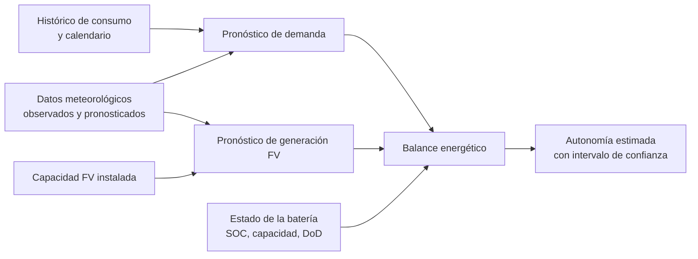

# Estado del arte: predicción del consumo eléctrico y estimación de la autonomía en sistemas fotovoltaicos con almacenamiento

Equipo 3 · Octubre de 2026

---

## Resumen

Este documento revisa las técnicas que se usan actualmente para predecir el consumo eléctrico con aprendizaje automático, y cómo esas predicciones se combinan con la generación fotovoltaica (FV) y el estado de la batería para estimar la autonomía energética de un sistema. La revisión no persigue identificar un vacío de investigación. Su objetivo es reunir los métodos, herramientas y fuentes de datos aplicables al problema con datos locales: un sistema compuesto exclusivamente por paneles solares y baterías, del que se conocen el consumo histórico, la capacidad FV instalada y las condiciones meteorológicas.

La literatura revisada coincide en descomponer el problema en dos pronósticos independientes, demanda y generación, y en integrarlos mediante un balance energético de la batería. Para el pronóstico de demanda, los modelos de *gradient boosting* con variables de calendario y clima son una referencia sólida, sobre todo con conjuntos de datos de tamaño moderado. Las arquitecturas neuronales recientes y los modelos fundacionales de series temporales son alternativas competitivas. La autonomía se obtiene, en la mayoría de los trabajos, simulando la evolución del estado de carga a partir de los pronósticos, preferiblemente bajo múltiples escenarios para cuantificar la incertidumbre. Esos escenarios deben ser coherentes entre la demanda y la generación, y los ensembles meteorológicos son la vía más directa para construirlos. Un ejemplo numérico a 72 horas muestra que, hasta el siguiente amanecer, la autonomía depende solo del pronóstico de demanda, mientras que en horizontes de varios días pasa a dominar la incertidumbre de la generación.

---

## Índice

1. [Formulación del problema](#1-formulación-del-problema)
2. [Trabajos de referencia](#2-trabajos-de-referencia)
3. [Predicción del consumo eléctrico](#3-predicción-del-consumo-eléctrico)
4. [Predicción de la generación fotovoltaica](#4-predicción-de-la-generación-fotovoltaica)
5. [Estimación de la autonomía](#5-estimación-de-la-autonomía)
6. [Cuantificación de la incertidumbre](#6-cuantificación-de-la-incertidumbre)
7. [Evaluación y validación](#7-evaluación-y-validación)
8. [Herramientas de software](#8-herramientas-de-software)
9. [Fuentes de datos públicas](#9-fuentes-de-datos-públicas)
10. [Contexto nacional](#10-contexto-nacional)
11. [Síntesis](#11-síntesis)
12. [Referencias](#referencias)

---

## 1. Formulación del problema

La autonomía de un sistema FV con batería rara vez se predice directamente. Los trabajos revisados la obtienen como resultado de combinar tres componentes:



1. Un modelo de pronóstico de demanda, que estima la energía que se consumirá en el horizonte de interés.
2. Un modelo de pronóstico de generación FV, a partir de la capacidad instalada y del pronóstico meteorológico.
3. Un modelo del almacenamiento, que integra ambos pronósticos y calcula cuándo el estado de carga alcanza su límite inferior.

Separar la demanda de la generación tiene respaldo empírico. En sistemas con generación detrás del contador, pronosticar ambas componentes por separado y combinarlas ha dado mejores resultados que pronosticar directamente la carga neta [25, 26]. En hogares individuales se ha observado además que incorporar la generación FV a la serie de consumo puede degradar la precisión del pronóstico [27].

---

## 2. Trabajos de referencia

Los tres trabajos siguientes son los más próximos al problema planteado: predecir el consumo y estimar, junto con la generación FV y la batería, cuánto durará la energía disponible.

### 2.1 Guillén-Asensio et al. (2021), IEEE Access [38]

*Energy Shortage Failure Prediction in Photovoltaic Standalone Installations by Using Machine Learning Techniques.*

- **Sistema y objetivo:** una instalación FV aislada en funcionamiento real en Aragón (España). El objetivo es anticipar con dos días de antelación los fallos por falta de energía, a partir de la predicción del voltaje de la batería.
- **Modelos:** se comparan dos redes recurrentes, NARX y LSTM.
- **Entradas:** el voltaje, la corriente y la temperatura de la batería, junto con varios escenarios futuros derivados del pronóstico meteorológico.
- **Resultado:** el error obtenido es de 1,2 V (RMSE) en baterías de 48 V, evaluado precisamente en los periodos críticos en que la instalación se aproxima al agotamiento.
- **Trabajos relacionados del mismo grupo:** una versión basada en regresión de procesos gaussianos y un trabajo previo presentado en EVER 2020.
- **Relevancia:** es el antecedente más directo de la estimación de autonomía. Además ilustra una forma de incorporar la incertidumbre meteorológica mediante escenarios.

### 2.2 Alnejaili, Labdai y Chrifi-Alaoui (2021), Sensors [37]

*Predictive Management Algorithm for Controlling PV-Battery Off-Grid Energy System.*

- **Sistema:** un sistema aislado formado por un generador FV, baterías LiFePO4 con sistema de gestión (BMS), un inversor híbrido y una unidad de control de cargas.
- **Modelo de pronóstico:** una red LSTM estima a corto plazo la potencia FV disponible y la potencia que puede entregar la batería. El algoritmo de gestión incorpora además las condiciones meteorológicas, en particular la temperatura.
- **Funcionamiento:** con los pronósticos de energía disponible y de estado de carga, el algoritmo decide qué cargas alimentar.
- **Resultado:** en simulación (Matlab/Simulink), el déficit energético se redujo aproximadamente un 53 % respecto al sistema sin gestión, y la probabilidad de pérdida de suministro bajó del 5 % al 3 %.
- **Relevancia:** representa la cadena completa de pronóstico, balance de la batería y decisión operativa. Muestra además una aplicación concreta de la estimación de autonomía: la priorización de cargas.

### 2.3 Kizilcec, Spataru, Lipani y Parikh (2022), Energies [24]

*Forecasting Solar Home System Customers' Electricity Usage with a 3D Convolutional Neural Network to Improve Energy Access.*

- **Datos:** consumo de 63 299 usuarios de sistemas solares domésticos con batería, sin conexión a la red, en Ruanda.
- **Modelo y horizontes:** una red convolucional tridimensional que pronostica el consumo por hogar a 24 horas, a 7 días y como semana media de los tres meses siguientes. El mejor resultado se obtuvo en este último escenario (MSE = 0,369), y el modelo superó a la referencia ingenua.
- **Hallazgos:** cerca del 70 % de los usuarios redujo su consumo un año después de la instalación. Los autores señalan además que el pronóstico en este tipo de sistemas es más difícil que en hogares conectados a la red.
- **Relevancia:** es la referencia principal sobre pronóstico de consumo en sistemas FV con batería aislados, el mismo tipo de sistema que se estudia aquí.

Como referencia complementaria para la selección de modelos de demanda destaca Meyer et al. (2025) [16]. Es la comparación más rigurosa encontrada entre modelos modernos y referencias clásicas en consumo doméstico horario (sección 3.5).

---

## 3. Predicción del consumo eléctrico

### 3.1 Revisiones generales

- **Dong et al. (2025) [1]:** revisan una década de aprendizaje profundo aplicado al pronóstico de demanda a corto plazo. Cubren todo el proceso: preprocesamiento, extracción de características, modelado y evaluación.
- **Hong y Fan (2016) [3]:** la referencia clásica del pronóstico probabilístico de demanda.
- **Revisión de pronóstico en baja tensión (2021) [4]:** se centra en la escala de hogares y edificios.
- **Revisión sobre redes inteligentes (2025) [2]:** recoge los desarrollos más recientes en modelos avanzados de aprendizaje automático.

### 3.2 Demanda y consumo servido

En un sistema aislado, el consumo medido no siempre coincide con la demanda. Cuando la batería alcanza su límite inferior, el BMS o el inversor interrumpen el suministro y el consumo registrado cae a cero, aunque la demanda real persista. Esas observaciones son demanda no servida y, en términos estadísticos, constituyen datos censurados.

Este hecho tiene varias consecuencias metodológicas:

- Los periodos de interrupción deben identificarse, a partir del estado de carga o del voltaje cuando estén disponibles, o bien por caídas abruptas a cero en horarios de uso habitual.
- Esos periodos deben tratarse como valores faltantes y no como consumo nulo. En caso contrario, el modelo tiende a subestimar la demanda justamente en los días de baja irradiancia, que son los más relevantes para la autonomía.
- La autonomía debe calcularse sobre la demanda estimada, no sobre el consumo servido.

**Tratamiento de los periodos censurados.** Hay cuatro opciones, de menor a mayor complejidad:

| Método | Descripción | Consideraciones |
|---|---|---|
| Exclusión | Se eliminan del entrenamiento y del cálculo de métricas las horas censuradas y, en modelos con retardos, las horas cuyos retardos caen en periodos censurados | Sencillo. Si los cortes se concentran en días nublados, el conjunto de entrenamiento queda sesgado hacia días despejados |
| Imputación por días análogos | Se sustituye cada hora censurada por la media de la misma hora en días comparables (mismo tipo de día, temporada y condiciones meteorológicas similares) | Conserva la forma del perfil diario. Atenúa la variabilidad de la demanda real |
| Imputación con el propio modelo | Se entrena un modelo inicial solo con periodos no censurados, se imputan con él los periodos censurados y se reentrena con la serie completa | Coherente con el modelo final. El error de imputación se propaga a los retardos |
| Verosimilitud censurada | En la hora en que se produce el corte, el consumo registrado es una cota inferior de la demanda. Los modelos de tipo Tobit [73] tratan estas observaciones como desigualdades y no como valores exactos | El más riguroso desde el punto de vista estadístico. Requiere una función de pérdida específica, no disponible por defecto en las bibliotecas habituales |

Un fenómeno distinto, y más difícil de corregir, es la **demanda suprimida**. Los usuarios que han sufrido cortes reiterados limitan de forma permanente su consumo, de modo que la demanda latente supera a la observada incluso en periodos sin interrupciones. Ningún método de imputación recupera este efecto a partir de los datos de consumo. Para la estimación de autonomía basta con modelar la demanda que efectivamente se producirá, aunque la diferencia es relevante si el modelo se usa para dimensionar el sistema.

A ello se suma el cambio del patrón de uso con el tiempo documentado en [24], que recomienda reentrenar los modelos periódicamente y validarlos siempre en orden temporal.

### 3.3 Variables explicativas

| Tipo | Variables | Observaciones |
|---|---|---|
| Autorregresivas | Retardos (t−1, t−24, t−168), medias y desviaciones móviles | Suelen ser las más informativas. En un estudio en edificios explicaban el 69,5 % de la varianza [12b] |
| Calendario | Hora, día de la semana, mes, festivos, periodos vacacionales, codificación cíclica | Presentes en la práctica totalidad de los trabajos |
| Temperatura | Temperatura, sus retardos y promedios, grados-día de refrigeración | La variable meteorológica más utilizada. En clima cálido se asocia a la climatización |
| Humedad | Humedad relativa, punto de rocío, índice de calor | Especialmente relevante en meses cálidos y en climas tropicales [5a, 5c] |
| Radiación y nubosidad | Irradiancia global y cobertura nubosa | Influencia moderada sobre la demanda y determinante sobre la generación |
| Estacionalidad tropical | Temporada seca o lluviosa, precipitación | En Makassar (Indonesia), dos modelos difusos, uno por temporada y a 24 horas, alcanzaron MAPE inferiores al 2,95 % [5b] |
| Estado del sistema | Indicador de interrupción, estado de carga al inicio del día | Ver sección 3.2. El usuario puede moderar su consumo cuando la batería está baja |

En el ámbito caribeño existe un conjunto de datos público del sistema eléctrico de la República Dominicana (2021–2024). Incluye demanda horaria, temperatura y humedad procedentes de Open-Meteo, retardos y variables de calendario [6].

### 3.4 Familias de modelos

| Familia | Modelos | Ventajas | Limitaciones |
|---|---|---|---|
| Referencias | Persistencia estacional, media estacional, SARIMA(X), ETS, MSTL | Necesarias para contextualizar cualquier resultado. En ocasiones difíciles de superar | Capacidad limitada para relaciones no lineales con el clima |
| *Gradient boosting* | LightGBM [7], XGBoost, CatBoost, Random Forest | Métodos ganadores en GEFCom 2012, 2014 y 2017 [8] y en M5 [14]. Eficientes, robustos con pocos datos y aptos para regresión cuantílica | Dependen de la ingeniería de variables y de una estrategia multipaso |
| Redes recurrentes | LSTM, GRU, NARX, CNN-LSTM | Ampliamente utilizadas. Con función de pérdida *pinball* producen cuantiles por hogar [21] | Sensibles a la configuración de hiperparámetros |
| Redes convolucionales | CNN 1D y 3D | Aplicadas a sistemas aislados [24] y a pronóstico cuantílico en 222 hogares de Pecan Street [23] | Menor difusión |
| Arquitecturas recientes | N-BEATSx [9], N-HiTS, TiDE [10], PatchTST, iTransformer | Eficientes. N-BEATSx y TiDE admiten variables exógenas | Requieren más datos |
| Transformers con exógenas | TFT [11], TimeXer [13] | Tratan el pronóstico meteorológico como entrada futura conocida. TFT es interpretable y produce cuantiles | Mayor coste computacional |
| Modelos fundacionales | Chronos-2, Chronos-Bolt, TimesFM, Moirai, TinyTimeMixer | Predicción sin entrenamiento específico (*zero-shot*), útil con históricos cortos | Tienden a subestimar picos. La mayoría son univariados |

**Comparación entre *gradient boosting* y aprendizaje profundo.** La evidencia no es concluyente y depende del volumen de datos, del horizonte y del esfuerzo de ingeniería de variables.

*Resultados favorables al boosting:*

- En una red de distribución griega, LightGBM superó a CNN, LSTM, GRU y CNN-LSTM en todas las métricas (MAPE del 1,20 %), con carga, temperatura, humedad y festivos como entradas [12a].
- En un edificio de oficinas, XGBoost superó a LSTM, GRU y CNN 1D con unas 17 000 muestras (MAPE del 3,5 %) [12b].
- En una tesis sobre el sistema de Kazajistán con datos sintéticos, XGBoost obtuvo un MAPE del 7,15 % frente al 11,73 % de LSTM [12c].
- En la competición M5, casi todos los métodos mejor clasificados emplearon LightGBM con modelos globales, es decir, un único modelo entrenado sobre múltiples series relacionadas [14].

*Resultados favorables al aprendizaje profundo:*

- Un estudio de 2026 con nueve arquitecturas sobre datos de contadores inteligentes concluyó que estas superan de forma consistente a las referencias clásicas. También encontró que las arquitecturas ligeras rinden de forma comparable a las más complejas [15].
- Con datos irlandeses, una LSTM global superó a SARIMA y a redes *feed-forward*, con un error medio al menos un 3 % inferior [12d].

*Resultados para pronóstico cuantílico por hogar:* un estudio de 2024 comparó bosques de regresión cuantílica, redes neuronales cuantílicas, *gradient boosting* cuantílico y LSTM cuantílica. Su enfoque basado en agrupamiento de hogares mejoró la cobertura de los intervalos [22]. Las combinaciones de ambas familias, como la extracción de patrones con redes neuronales seguida de XGBoost o los ensembles, también aparecen con frecuencia [12].

**Características de los modelos con variables exógenas:**

- **TFT [11]** distingue covariables estáticas, entradas futuras conocidas y variables observadas solo en el pasado, e incorpora mecanismos de selección de variables.
- **TimeXer [13]** combina atención por segmentos sobre la serie objetivo con atención cruzada hacia las variables exógenas. Reporta resultados de estado del arte en doce conjuntos de referencia.
- **N-BEATSx [9]** mejora cerca de un 20 % respecto a N-BEATS en pronóstico de precios eléctricos.

Conviene, por último, tratar con cautela las comparaciones tomadas de tablas publicadas. Los autores de TiDE detectaron un error en el cargador de datos de evaluación de PatchTST que inflaba sus resultados en conjuntos pequeños [10].

**Funcionamiento de los modelos principales.** La elección entre familias depende en buena medida de cómo cada una aprende la relación entre las entradas y el consumo:

- ***Gradient boosting* (LightGBM, XGBoost).** El modelo es una suma de árboles de decisión entrenados en secuencia. Cada árbol nuevo se ajusta al gradiente de la función de pérdida respecto a la predicción acumulada de los anteriores; con pérdida cuadrática, ese gradiente es el residuo [74]. Cada árbol divide el espacio de entradas mediante umbrales, por ejemplo "retardo de 24 h superior a 0,6 kW y hora entre 18 y 22", y asigna un valor constante a cada región. De ello se derivan tres propiedades relevantes:
  - captura sin especificarlas de antemano las interacciones entre variables, como la dependencia del efecto de la temperatura respecto de la hora;
  - la información temporal solo entra a través de las variables construidas (retardos, medias móviles, calendario), por lo que la ingeniería de variables determina el resultado;
  - **no extrapola**: la predicción está acotada por los valores observados en entrenamiento. Ante temperaturas o niveles de consumo superiores a los del histórico, por ejemplo tras la incorporación de un nuevo equipo de climatización, el modelo satura.

  Para obtener cuantiles basta con sustituir la pérdida cuadrática por la pérdida *pinball* del cuantil deseado y entrenar un modelo por cuantil.
- **Redes recurrentes (LSTM, GRU).** Procesan la serie paso a paso y mantienen un estado interno que resume la historia. Las compuertas de la LSTM regulan qué información se conserva, se añade o se descarta en cada paso, lo que permite retener dependencias largas [75]. En pronóstico multipaso se usa habitualmente una arquitectura codificador-decodificador: el codificador recorre la ventana de historia, y el decodificador genera el horizonte a partir del estado final y de las entradas futuras conocidas (calendario y pronóstico meteorológico).
- **N-BEATS y N-HiTS.** Están formados por bloques de perceptrones multicapa apilados. Cada bloque produce una reconstrucción de la ventana de entrada (*backcast*) y una contribución al pronóstico (*forecast*). La reconstrucción se resta de la entrada antes de pasarla al bloque siguiente, de modo que cada bloque modela lo que los anteriores no explicaron [76]. N-HiTS añade submuestreo a distintas resoluciones e interpolación jerárquica, de modo que unos bloques se especializan en la tendencia y el ciclo diario y otros en las fluctuaciones de alta frecuencia [77].
- **TFT.** Combina cuatro componentes: redes de selección de variables, que ponderan la relevancia de cada entrada en cada instante; un codificador-decodificador LSTM para los patrones locales; atención multicabezal para las dependencias largas, interpretable porque indica qué instantes pasados influyen en cada predicción; y una salida de varios cuantiles [11]. Su separación explícita entre entradas pasadas, futuras conocidas y estáticas se ajusta bien al problema, ya que el pronóstico meteorológico es una entrada futura conocida.
- **Chronos.** Trata la serie como un texto. Escala cada serie por su media absoluta y cuantiza los valores escalados en un vocabulario fijo de intervalos; cada intervalo es un *token*. Un modelo de lenguaje de la familia T5 se entrena con entropía cruzada para predecir el siguiente *token* [78]. Como el modelo produce una distribución sobre los *tokens* siguientes, el muestreo genera **trayectorias completas** y no solo cuantiles por hora, una propiedad directamente útil para la simulación por escenarios (sección 5.5). Chronos-Bolt divide la serie en segmentos (*patches*) y emite directamente varios cuantiles, lo que acelera la inferencia. Chronos-2 añade el uso de covariables [17].

### 3.5 Modelos fundacionales en consumo doméstico

**Meyer et al. (2025) [16]** evaluaron los principales modelos fundacionales sobre consumo horario de hogares.

- **Datos:** IDEAL (254 hogares, Reino Unido), Lower Saxony (34, Alemania), Southern Germany (6) y REFIT (20).
- **Configuración:** horizontes y ventanas de contexto de 24, 96 y 168 horas.
- **Modelos comparados:** Chronos, Chronos-Bolt, Lag-Llama, Moirai, Sundial, Time-MoE, TimesFM y TimesFM 2.0, frente a PatchTST, iTransformer y TFT entrenados desde cero.
- **Resultados:**
  - Chronos-Bolt obtuvo el menor error absoluto medio normalizado en Lower Saxony (0,490) y REFIT (0,528). TimesFM 2.0 fue el mejor en IDEAL (0,509).
  - PatchTST fue el mejor con contextos cortos.
  - La media estacional resultó una referencia exigente, que Lag-Llama y Moirai no lograron superar.
- **Limitaciones señaladas por los autores:** la subestimación de picos de demanda, la posible fuga de información desde los datos de preentrenamiento y el carácter univariado de la evaluación.

**Otros resultados relevantes:**

- **Chronos-2 [17]** admite covariables pasadas y futuras conocidas, lo que permite incorporar el pronóstico meteorológico. La documentación de AutoGluon incluye precisamente un caso de pronóstico de carga a 24 horas con covariables meteorológicas [18].
- **En el sistema ERCOT**, Chronos-2 produjo intervalos de predicción bien calibrados, a diferencia de otros modelos del mismo tipo: cobertura empírica del 95 % con nivel nominal del 90 %, es decir, ligeramente conservadores [19].
- **BuildingsBench [20]** muestra que el preentrenamiento con 900 000 edificios simulados se transfiere mejor a edificios comerciales que a residenciales.

### 3.6 Formulación supervisada y estrategias multipaso

Los modelos de aprendizaje automático no pronostican series temporales directamente. Lo habitual es reformular el problema como regresión supervisada: para cada instante de origen $t$ se construye un vector de entrada y un objetivo a $h$ pasos vista.

- **Vector de entrada:** valores pasados del consumo, variables de calendario del instante objetivo y pronóstico meteorológico disponible en $t$.
- **Objetivo:** el consumo en $t+h$.

El procedimiento típico en los trabajos revisados consta de cinco etapas:

1. **Preprocesamiento.**
   - Remuestreo a una resolución común, normalmente horaria.
   - Tratamiento de faltantes y de valores atípicos.
   - Identificación de periodos censurados (sección 3.2).
   - En modelos neuronales, normalización por instalación.
2. **Ingeniería de variables.**
   - Retardos y estadísticos móviles calculados solo con información disponible en el instante de origen.
   - Calendario.
   - Variables meteorológicas alineadas con el instante objetivo.
3. **Estrategia multipaso.** Se elige cómo producir los $H$ valores del horizonte. La revisión de Ben Taieb et al. [67] compara las siguientes:

   | Estrategia | Descripción | Consideraciones |
   |---|---|---|
   | Recursiva | Un modelo a un paso; sus predicciones se reinyectan como retardos para avanzar en el horizonte | Un solo modelo. Los errores se acumulan con el horizonte |
   | Directa | Un modelo independiente para cada paso $h = 1, \dots, H$ | Sin acumulación de errores. Más modelos que entrenar y posibles incoherencias entre pasos contiguos |
   | DirRec | Combinación de las dos anteriores: un modelo por paso que además recibe las predicciones previas | Compromiso intermedio |
   | MIMO | Un único modelo que emite el vector completo de $H$ valores | Preserva la dependencia entre pasos. Es el esquema natural de N-BEATS, N-HiTS, TiDE y TFT |

   Ninguna estrategia domina en todos los contextos. La estrategia *rectify* de Ben Taieb y Hyndman [68], que corrige con modelos directos el sesgo de las predicciones recursivas, ha mostrado un rendimiento igual o superior al mejor de ambos enfoques. Con LightGBM, una práctica común es el enfoque directo, o un único modelo que recibe el paso $h$ como variable de entrada.
4. **Entrenamiento y ajuste de hiperparámetros**, siempre con validación temporal.
5. **Calibración de la incertidumbre** (sección 6).

Una configuración representativa de LightGBM para consumo horario, a partir de las variables de la sección 3.3, incluye:

- retardos de 1, 2, 3, 24, 48 y 168 horas;
- medias móviles de 24 y 168 horas;
- hora y día de la semana con codificación cíclica, y un indicador de festivo;
- temperatura y humedad pronosticadas para la hora objetivo;
- en modelos globales, un identificador de instalación.

Con la estrategia directa, los retardos inferiores a $h$ no están disponibles para el paso $h$ y deben excluirse.

**Degradación del error con el horizonte.** La estimación de autonomía requiere horizontes de 24 a 72 horas o más, superiores al día siguiente en que se concentra la mayor parte de la literatura. El error crece con el horizonte por tres mecanismos:

- **Pérdida de información autorregresiva.** Los retardos más recientes, que son los más informativos (sección 3.3), dejan de estar disponibles. A 48 horas vista, el retardo más reciente utilizable en la estrategia directa es el de 48 horas.
- **Degradación del pronóstico meteorológico.** El error de las variables meteorológicas de entrada aumenta con la anticipación, y se transmite a la demanda en la medida en que esta depende del clima.
- **Convergencia hacia la climatología condicional.** A horizontes largos, la mejor predicción posible se aproxima al perfil medio para ese tipo de día, hora y temporada. La ventaja de cualquier modelo sobre la media estacional disminuye, y llega a anularse.

En consecuencia, conviene evaluar los modelos por separado para cada paso del horizonte y comparar la curva de error con la de la media estacional. A partir del paso en que ambas curvas convergen, el modelo no aporta información, y en la simulación de la batería puede sustituirse por perfiles climatológicos con su dispersión histórica.

### 3.7 Efecto de la escala de agregación

La predictibilidad del consumo depende fuertemente del número de usuarios agregados:

- **Ley de escala de Sevlian y Rajagopal [69].** Con unos 200 000 clientes de Pacific Gas and Electric, el MAPE disminuye rápidamente al aumentar el número de consumidores agregados hasta cerca de 100 000. A partir de ahí la mejora es marginal.
- **Peñaloza et al. [70].**
  - El MAPE individual de los hogares varió entre el 1 % y el 45 %.
  - Pronosticar el agregado fue más preciso que pronosticar cada hogar a partir de unos 20 consumidores.
  - Por debajo de 10 consumidores resultó preferible el pronóstico individual.
- **Órdenes de magnitud [4].** El MAPE suele estar por debajo del 2 % en subestaciones de transmisión y puede alcanzar el 30 % en consumidores residenciales.

Para una instalación FV individual, esto implica que el pronóstico puntual tendrá errores relativos elevados, por la volatilidad inherente al comportamiento de los usuarios. Por eso el pronóstico probabilístico tiene especial valor a esta escala, y las métricas porcentuales deben interpretarse con cautela (sección 7). Kong et al. [64] mostraron que una LSTM supera a los métodos de referencia en el pronóstico a corto plazo de hogares individuales, precisamente por su capacidad para captar patrones de comportamiento irregulares.

### 3.8 Modelos globales y locales

Cuando se dispone de datos de varias instalaciones, hay dos alternativas: entrenar un modelo por instalación (modelo local) o un único modelo para todas (modelo global).

- **Fundamento teórico.** Montero-Manso y Hyndman [66] demuestran que los modelos globales no son más restrictivos que los locales y pueden producir los mismos pronósticos sin suponer similitud entre series. Además:
  - su complejidad no crece con el número de series;
  - admiten memorias autorregresivas más largas;
  - obtienen buenos resultados incluso con series heterogéneas.
- **Evidencia en consumo doméstico.** Shi, Xu y Li [65] propusieron una red recurrente profunda que agrupa los perfiles de múltiples clientes en un único conjunto de entrenamiento (*pooling*), para mitigar el sobreajuste propio de los datos de un solo hogar. Con 920 clientes irlandeses, mejoró el RMSE un 19,5 % respecto a ARIMA, un 13,1 % respecto a SVR y un 6,5 % respecto a una red recurrente profunda convencional.
- **Competiciones.** El mismo principio explica el dominio de los modelos globales de LightGBM en M5 [14].

En la práctica, un modelo global con variables que identifiquen la instalación (capacidad FV, capacidad de la batería, número de ocupantes, si se conoce) permite compartir información entre instalaciones. También permite pronosticar instalaciones con poco histórico.

### 3.9 Instalaciones sin histórico

Las instalaciones nuevas carecen de datos suficientes para entrenar un modelo propio. La literatura sobre electrificación rural recoge tres respuestas:

- **Modelos con información auxiliar.** Con 1 378 clientes de minirredes en Tanzania, los modelos que incorporan encuestas a los usuarios superaron a las referencias. El mejor fue una regresión LASSO, con un error absoluto mediano del 66 % por conexión y del 37 % por emplazamiento [72]. Otros estudios en Kenia, sin embargo, encontraron que las respuestas a encuestas por sí solas predicen mal el consumo individual [72].
- **Modelos globales** entrenados con otras instalaciones (sección 3.8).
- **Modelos fundacionales** en modo *zero-shot*, que requieren solo una ventana de contexto corta (sección 3.5).

### 3.10 Ajuste, interpretación y diagnóstico

- **Ajuste de hiperparámetros.** La búsqueda debe realizarse dentro de la validación temporal, nunca sobre particiones aleatorias. Las herramientas de optimización bayesiana, como Optuna [79], reducen el número de configuraciones evaluadas y permiten interrumpir anticipadamente las que no prometen. En LightGBM, los hiperparámetros más influyentes suelen ser el número de hojas, la tasa de aprendizaje con el número de árboles asociado y la regularización.
- **Interpretación.** Los valores SHAP [80] descomponen cada predicción en la contribución de cada variable. Su uso principal en este problema es la verificación de plausibilidad: el modelo debe aumentar la demanda con la temperatura en las horas de climatización, y no depender de variables espurias como un identificador temporal.
- **Diagnóstico de residuos.** Un modelo adecuado deja residuos sin estructura. Conviene comprobar:
  - el sesgo por hora del día, por tipo de día y por temporada, ya que un sesgo sistemático nocturno afecta directamente a la autonomía (sección 5.8);
  - la autocorrelación de los residuos, cuya presencia indica información temporal no aprovechada y, además, condiciona la generación de escenarios (sección 5.5);
  - la relación entre los residuos y el estado de carga, que revela si el usuario modera su consumo cuando la batería está baja (sección 3.3).

---

## 4. Predicción de la generación fotovoltaica

### 4.1 Síntesis de enfoques

- **Modelos físicos.** Calculan la potencia a partir de la posición solar, la irradiancia sobre el plano del generador, la temperatura de célula, la potencia nominal y las pérdidas. La biblioteca de referencia es pvlib python [28], que implementa más de cien modelos publicados. No requieren histórico de generación, lo que los hace adecuados cuando solo se conoce la capacidad instalada.
- **Modelos basados en datos.** Relacionan las variables meteorológicas con la potencia generada. En revisiones recientes, LSTM y CNN figuran entre las arquitecturas de aprendizaje profundo más frecuentes [29, 30].
- **Modelos híbridos.** Combinan enfoques físicos y basados en datos mediante variables de origen físico, calibración de parámetros o corrección de residuos con aprendizaje automático [31a]; hay también híbridos probabilísticos intra-día [31b]. En la literatura revisada, los modelos híbridos suelen reportar los mejores resultados, con errores normalizados (NRMSE, MAE) frecuentemente por debajo del 5% [85].
- **Elección según el horizonte.** La literatura clasifica los modelos de generación según el horizonte temporal y la fuente de datos empleada:

| Horizonte | Rango | Uso típico | Fuente de datos principal |
|---|---|---|---|
| Intra-hora | < 1 h | Despacho en tiempo real, calidad de energía | Histórico de potencia, cámaras de cielo |
| Intra-día | 1–24 h | Programación del día siguiente, mercado eléctrico | Imágenes satelitales, NWP a corto plazo |
| Día siguiente | 24–48 h | Mantenimiento, asignación de recursos | NWP (Predicción Numérica del Tiempo) [32, 33] |
| Mediano plazo | 48 h – 1 mes | Gestión de activos, planificación estacional | NWP de mediano plazo, climatología |
| Largo plazo | > 1 mes | Expansión de capacidad, políticas | Climatología e históricos |

La precisión de los modelos empeora de forma general a medida que el horizonte de predicción crece [86]. Para estimar autonomías de horas a días, el pronóstico NWP es la fuente operativa más práctica.

**Variables de entrada y factores críticos:**
- Las entradas típicas abarcan variables meteorológicas (irradiancia, temperatura ambiente y de célula, humedad, nubosidad, viento), temporales y de configuración del sistema (inclinación, eficiencia del inversor).
- **Variables derivadas:** El uso del índice de claridad (irradiancia real frente a la máxima teórica) y de la posición solar (azimut y cenit) mejora de forma notable el rendimiento de los modelos [85].
- **Clasificación de clima:** Incorporar una clasificación previa del tipo de clima (despejado, parcialmente nublado, cubierto) es uno de los factores que más incrementa la precisión [86]. En particular, las condiciones de nubosidad parcial generan fluctuaciones rápidas de potencia y representan un reto notable para algoritmos como las máquinas de vectores de soporte (SVM) [85].
- **Optimización:** El rendimiento depende fuertemente de una selección adecuada de variables y de una rigurosa sintonización de hiperparámetros mediante optimización bayesiana, búsqueda en rejilla/aleatoria, algoritmos genéticos o PSO [85].

**Generación frente a demanda:** Estudios comparativos a nivel residencial (como el análisis entre Prophet y redes neuronales resumido en [85]; la fuente primaria probable es [87]) muestran que la generación solar puede predecirse con coeficientes de determinación $R^2$ de hasta 0.981, mientras que el pronóstico de consumo en el mismo hogar alcanza valores máximos de $R^2 \approx 0.523$ debido a la alta estocasticidad del comportamiento humano. Esto sugiere que el mayor desafío analítico del proyecto reside en la predicción de la demanda, más que en la generación fotovoltaica.

### 4.2 Requisitos para la integración con el modelo de autonomía

Para que el pronóstico FV pueda combinarse con el de demanda en el balance de la batería, debe cumplir varias condiciones:

| Aspecto | Requisito |
|---|---|
| Resolución temporal | Igual a la del pronóstico de demanda, preferiblemente horaria |
| Horizonte | Igual al de la estimación de autonomía, por ejemplo de 24 a 72 horas |
| Representación | Cuantiles o escenarios, no solo un valor puntual |
| Entradas meteorológicas | Las mismas que el modelo de demanda, para que los escenarios sean coherentes entre sí |
| Punto de medida | Potencia en continua o en alterna (tras el inversor), para aplicar correctamente las eficiencias del balance |

EMHASS [34] es una referencia de integración. Esta herramienta de código abierto encadena el pronóstico meteorológico de Open-Meteo, el modelado FV con pvlib, el pronóstico de carga con aprendizaje automático y la optimización de la batería.

### 4.3 Datos meteorológicos

| Fuente | Contenido | Observaciones |
|---|---|---|
| Open-Meteo | Histórico (ERA5, desde 1940), pronósticos históricos y pronóstico operativo | La resolución de ERA5 (~25 km) puede no captar efectos costeros locales [54] |
| NASA POWER | Irradiancia, temperatura y humedad globales | Presenta sesgos en irradiancia. Con *quantile mapping*, la desviación absoluta media diaria en los sitios estudiados bajó de 4–19 a 3–7 W/m² [55a] |
| ERA5 (Copernicus) | Reanálisis horario | Base de los datos históricos de Open-Meteo |
| Estaciones del INSMET | Observaciones locales | Útiles para validar y corregir sesgos |

NASA POWER y ERA5 son estimaciones y no mediciones, por lo que conviene contrastarlas con observaciones locales antes de usarlas. Mutlu [55b] las compara con datos in situ, pero para temperatura, presión y viento, no para radiación. No se ha localizado una fuente verificada del error en radiación.

Para entrenar modelos que vayan a operar con pronósticos, conviene usar como entradas los pronósticos históricos y no las observaciones. Así las condiciones de entrenamiento coinciden con las de operación.

---

## 5. Estimación de la autonomía

### 5.1 Definiciones

- **Autonomía (en días u horas):** tiempo durante el cual la batería puede abastecer la carga sin aporte de generación. La norma AS/NZS 4509.2 la define como los días de operación sin aporte del generador antes de superar la profundidad de descarga máxima de diseño [35c]. En diseño se suelen adoptar entre 2 y 5 días: unos 2 con generador de arranque automático, 2–3 con arranque manual y 4–5 sin generador [35c]. La guía de Penn State liga los días a la disponibilidad exigida: unos 3 para el 95 % y unos 10 para el 99 % con 4–5 horas solares pico [35b].
- **Probabilidad de pérdida de suministro (LPSP):** fracción de la demanda no cubierta. Mientras la autonomía es un parámetro de diseño determinista, la LPSP es su contrapartida probabilística [36].
- **Estado de carga (SOC):** energía disponible en relación con la capacidad útil de la batería.

En diseño, la autonomía suele calcularse suponiendo generación nula. En operación interesa una magnitud distinta: el tiempo hasta el agotamiento considerando la generación FV pronosticada. Esa es la magnitud que estiman los trabajos [37] y [38].

### 5.2 Estado inicial y capacidad efectiva

La estimación parte de dos magnitudes que deben conocerse en el instante de cálculo $t_0$:

- **Estado de carga inicial.** Si el BMS lo reporta, se toma directamente. En caso contrario se estima de una de dos formas:
  - por integración de la corriente (*coulomb counting*), que acumula deriva y requiere recalibraciones periódicas en estados conocidos, como la carga completa;
  - a partir del voltaje en reposo mediante la curva característica de la batería, un método fiable en plomo-ácido pero poco preciso en LiFePO4, cuya curva es muy plana en la zona media.

  También se han empleado redes recurrentes para estimar y predecir el estado de carga [42].
- **Capacidad útil efectiva.** Es la capacidad nominal multiplicada por la profundidad de descarga admisible y corregida por el estado de salud (sección 5.9).

Un error en cualquiera de las dos magnitudes se traslada de forma directa a la autonomía estimada, con independencia de la calidad de los pronósticos.

Cuando se dispone tanto de la corriente como del voltaje, ambos métodos pueden combinarse mediante un filtro de Kalman. La integración de corriente actúa como modelo de evolución y el voltaje, a través de un modelo de circuito equivalente de la batería, como observación que corrige la deriva. Es el método habitual en los BMS de mayor calidad, y el mismo tipo de filtro se ha empleado para gestionar la incertidumbre de la carga en control predictivo [47].

### 5.3 Modelo del sistema de almacenamiento

La ecuación de balance de la sección 5.4 trata la batería como un depósito de energía con eficiencias constantes. Es una aproximación suficiente en muchos casos, pero omite efectos que, en un sistema aislado, pueden modificar la autonomía en varias horas:

| Efecto | Descripción | Tratamiento en la simulación |
|---|---|---|
| Consumo propio del inversor | El inversor consume energía de forma continua mientras está encendido, incluso sin carga conectada, normalmente del orden de decenas de vatios | Sumarlo a la demanda pronosticada. A lo largo de una noche puede representar una fracción apreciable de la energía extraída |
| Límites de potencia | El inversor limita la potencia de descarga y el regulador la de carga. La batería tiene además una tasa máxima de carga y descarga (tasa C) | Acotar en cada paso los flujos de carga y descarga. Si la generación excede el límite de carga, el excedente se pierde aunque la batería no esté llena |
| Aceptación de carga cerca del máximo | En plomo-ácido, la fase final de carga (absorción) se realiza a voltaje constante y con corriente decreciente, por lo que la batería no absorbe toda la generación disponible | Reducir el límite de carga en función del estado de carga por encima de un umbral |
| Efecto Peukert | En plomo-ácido, la capacidad efectiva disminuye al aumentar la corriente de descarga | Corregir la capacidad útil según la potencia media de descarga. Es poco relevante en litio |
| Temperatura | La capacidad disponible disminuye a baja temperatura; las temperaturas altas aceleran el envejecimiento | En clima cálido, el efecto principal es el envejecimiento (sección 5.9) |
| Autodescarga | Pérdida lenta de carga en reposo | Despreciable en horizontes de días en baterías de litio |
| Eficiencia variable | Las eficiencias de carga y descarga dependen de la potencia y del estado de carga | Estimarlas a partir del histórico (sección 5.7) en lugar de tomar valores nominales |

**Generación recortada por batería llena.** Cuando la batería está llena y la demanda es inferior a la generación disponible, el regulador reduce la potencia extraída de los paneles. En la simulación, este efecto corresponde al término $\mathrm{clip}$ de la ecuación de balance. Tiene dos consecuencias para el resto del sistema:

- **En los datos históricos.** La generación FV medida en un sistema aislado está censurada, igual que el consumo (sección 3.2): en las horas con la batería llena, la generación registrada es inferior a la potencial. Si el modelo de generación se calibra con estos datos sin identificar dichas horas, subestimará la producción potencial. Este aspecto debe coordinarse con el modelado de la generación FV (sección 4).
- **En la simulación.** El pronóstico FV debe expresar la generación **potencial**, y el balance de la batería determina cuánta se aprovecha. Además, el error del pronóstico FV es irrelevante en las horas en que la batería está llena, ya que el excedente se pierde de todos modos (sección 5.8).

### 5.4 Simulación del balance energético

El enfoque más extendido, y también el más interpretable, consiste en simular la energía almacenada a partir de los pronósticos de demanda $\hat{P}_{load}$ y de generación $\hat{P}_{pv}$:

$$
E_{t+1} = \mathrm{clip}\Big(E_t + \eta_c \,[\hat{P}_{pv,t} - \hat{P}_{load,t}]^+ \Delta t \;-\; \tfrac{1}{\eta_d}\,[\hat{P}_{load,t} - \hat{P}_{pv,t}]^+ \Delta t,\; E_{min},\; E_{max}\Big)
$$

$$
\text{Autonomía}(t_0) = \min\{\,h \ge 0 : E_{t_0+h} \le E_{min}\,\}
$$

Los términos de la ecuación son:

- $E_t$: energía almacenada en kWh, es decir, el producto del SOC por la capacidad.
- $\eta_c$ y $\eta_d$: eficiencias de carga y descarga. Son del orden de 0,95 en baterías de litio y de 0,80–0,85 en plomo-ácido, valores que deben contrastarse con los datos del fabricante.
- $E_{min}$: límite inferior, determinado por la profundidad de descarga admisible.
- $E_{max}$: capacidad útil de la batería.

Si $E$ no alcanza $E_{min}$ dentro del horizonte, la autonomía se informa como superior a este. En horizontes largos, la recarga diaria puede hacer que la autonomía no esté acotada.

**Ejemplo ilustrativo.** Se considera una batería con capacidad útil de 10 kWh y límite inferior del 20 % ($E_{min}$ = 2 kWh). A las 18:00 el estado de carga es del 70 % ($E_{t_0}$ = 7 kWh) y la generación FV es nula hasta el amanecer. La eficiencia de descarga es $\eta_d$ = 0,95.

| Escenario de demanda nocturna | Demanda media | Energía extraída por hora ($\bar{L}/\eta_d$) | Autonomía ($(E_{t_0} - E_{min}) / (\bar{L}/\eta_d)$) | Agotamiento estimado |
|---|---|---|---|---|
| Baja (cuantil 0,1) | 0,45 kW | 0,474 kWh | 10,6 h | Hacia las 04:35 |
| Central (mediana) | 0,60 kW | 0,632 kWh | 7,9 h | Hacia las 01:55 |
| Alta (cuantil 0,9) | 0,80 kW | 0,842 kWh | 5,9 h | Hacia las 23:55 |

El ejemplo muestra dos aspectos relevantes:

- El cuantil alto de la demanda determina el cuantil bajo de la autonomía, que es el valor de interés para una alerta conservadora.
- La incertidumbre del pronóstico de demanda se traduce en un intervalo de autonomía de varias horas.

El ejemplo usa demandas constantes y omite la generación. El ejemplo siguiente incorpora ambos aspectos.

**Ejemplo con generación a varios días.** Se considera la misma batería ($E_{max}$ = 10 kWh, $E_{min}$ = 2 kWh, $\eta_c = \eta_d$ = 0,95), llena a las 18:00 del día 0, y se simulan 72 horas en pasos horarios. Los supuestos son los siguientes:

- **Demanda horaria:** 0,30 kW de 0:00 a 6:00; 0,60 kW de 6:00 a 9:00; 0,45 kW de 9:00 a 18:00; 0,90 kW de 18:00 a 22:00, y 0,50 kW de 22:00 a 24:00. El total es de 12,25 kWh diarios.
- **Generación FV:** perfil sinusoidal entre las 6:00 y las 18:00, con 16 kWh en un día despejado (D) y 5 kWh en un día nublado (N).

| Escenario (días 1, 2 y 3) | Demanda | Primer agotamiento | Energía no servida en 72 h | Horas sin suministro (aprox.) | Generación recortada |
|---|---|---|---|---|---|
| D-D-D | Nominal | No se produce | 0 kWh | 0 | 9,2 kWh |
| N-D-D | Nominal | Día 1, 18:18 (24,3 h) | 6,5 kWh | 13 | 5,2 kWh |
| N-N-D | Nominal | Día 1, 18:18 (24,3 h) | 13,8 kWh | 28 | 2,2 kWh |
| N-N-N | Nominal | Día 1, 18:18 (24,3 h) | 14,5 kWh | 30 | 0 kWh |
| D-D-D | +15 % | Día 1, 06:34 (12,6 h) | 1,0 kWh | 3 | 4,5 kWh |

Las cifras se han obtenido con la ecuación de balance anterior, y muestran cinco comportamientos que el ejemplo nocturno no recoge:

1. **La primera noche es común a todos los escenarios.** A las 6:00 del día 1 la batería conserva 3,26 kWh en todos los casos con demanda nominal. La generación solo diferencia los escenarios a partir del amanecer.
2. **El agotamiento no se produce durante el día nublado, sino al comienzo del pico vespertino.** Con 5 kWh de generación frente a 5,85 kWh de demanda diurna, la batería apenas desciende durante el día 1 (2,28 kWh a las 18:00). Se agota 18 minutos después de empezar el pico de las 18:00.
3. **El instante del primer agotamiento no distingue la gravedad del episodio.** Es idéntico en los tres escenarios con el día 1 nublado, mientras que la energía no servida varía entre 6,5 y 14,5 kWh. De ahí que convenga informar más de una magnitud (sección 5.6).
4. **Con generación abundante, una parte se pierde.** En el escenario despejado se recortan 9,2 kWh en los tres días, unos 3 kWh diarios, porque la batería se llena hacia las 14:00 y la generación de la tarde excede la demanda. Este excedente no está disponible para la noche siguiente, y explica por qué la generación medida en los días despejados subestima la potencial (sección 5.3).
5. **Un error moderado de demanda basta para provocar el agotamiento antes del amanecer, con independencia de la generación.** Con un 15 % más de demanda y tres días despejados, la batería se agota a las 06:34 del día 1, antes de que la generación cubra el pico matinal. En ese tramo, la autonomía depende exclusivamente del pronóstico de demanda.

Los puntos 2 y 5 muestran que la componente que domina la autonomía depende del momento: hasta el siguiente amanecer, solo importa la demanda; a lo largo de varios días, la diferencia entre un día despejado y uno nublado (11 kWh en este ejemplo) supera ampliamente un error del 15 % en la demanda diaria (1,8 kWh). La sección 5.8 desarrolla esta observación.

**Reestimación con horizonte móvil.** En operación, la estimación se repite periódicamente, por ejemplo cada hora, de forma análoga al control predictivo:

- se actualiza el estado de carga medido;
- se incorporan el último consumo observado y el pronóstico meteorológico más reciente;
- se recalcula la autonomía sobre el nuevo horizonte.

Este esquema corrige progresivamente los errores acumulados de los pronósticos y es el que aplican los sistemas de gestión predictiva [37, 48].

**Versión probabilística.** Cuando los pronósticos son probabilísticos, la simulación se repite sobre un conjunto de escenarios mediante Monte Carlo:

```text
para cada escenario s = 1, ..., S:
    obtener una trayectoria de demanda L_s(t) y una de generación PV_s(t),
        ambas condicionadas al mismo escenario meteorológico
    simular E_s(t) desde el estado de carga actual
    autonomía_s = primer instante en que E_s(t) ≤ E_min
resultado: percentiles P10, P50 y P90 de la autonomía
           y probabilidad de que sea inferior a un umbral dado
```

**Coherencia temporal de los escenarios.** Las trayectorias deben preservar la correlación temporal. Muestrear cuantiles de forma independiente en cada hora subestima la probabilidad de déficits prolongados. Para generar trayectorias coherentes hay tres opciones habituales:

- modelos generativos como DeepAR o Chronos;
- cópulas gaussianas sobre cuantiles [21];
- escenarios meteorológicos completos, como en [38].

En un estudio residencial, 200 escenarios generados con redes neuronales se redujeron a 15 representativos sin pérdida sustancial de información [43].

**Aplicaciones de este enfoque en la literatura:**

- La gestión predictiva de cargas en sistemas aislados [37].
- EMHASS [34].
- Marcos híbridos de pronóstico y optimización con análisis multiescenario [44].
- Evaluaciones del valor añadido de los pronósticos probabilísticos frente a los deterministas en sistemas FV con baterías [49].

### 5.5 Escenarios conjuntos de demanda y generación

La simulación por Monte Carlo requiere que cada escenario contenga una trayectoria de demanda y una de generación **coherentes entre sí**. La demanda y la generación dependen de las mismas variables meteorológicas: un día nublado reduce la generación y, a la vez, puede modificar la temperatura y, con ella, la demanda de climatización. Si ambas componentes se muestrean de forma independiente, se combinan días despejados en la generación con días nublados en la demanda, y se distorsiona la probabilidad de los episodios de déficit.

**Ensembles de predicción meteorológica.** El método más directo para obtener escenarios coherentes son los pronósticos por conjuntos (*ensembles*). Los centros meteorológicos ejecutan el mismo modelo numérico varias veces con condiciones iniciales perturbadas, y cada ejecución, o miembro, es una trayectoria meteorológica plausible y físicamente consistente. La API de ensembles de Open-Meteo ofrece, entre otros, el ensemble del ECMWF IFS (51 miembros, 15 días de horizonte) y el del GFS (31 miembros, 10 días), con resolución horaria [81]. El procedimiento es el siguiente:

```text
para cada miembro m = 1, ..., M del ensemble:
    meteorología_m(t)  ← temperatura, humedad, irradiancia, nubosidad del miembro m
    PV_m(t)            ← modelo de generación FV aplicado a meteorología_m
    L_m(t)             ← modelo de demanda con las variables meteorológicas de meteorología_m
    para cada réplica k = 1, ..., K:
        ε_k(t)         ← bloque de residuos históricos del modelo de demanda
        L_mk(t)        ← L_m(t) + ε_k(t)
        simular E_mk(t) con L_mk(t) y PV_m(t)
resultado: distribución de la autonomía sobre los M × K escenarios
```

Este esquema separa dos fuentes de incertidumbre:

- **La meteorológica**, representada por la dispersión entre miembros del ensemble. Afecta a la generación y, en menor medida, a la demanda.
- **La propia del comportamiento del usuario**, que no depende del clima. Se representa añadiendo residuos del modelo de demanda. Estos deben muestrearse en bloques contiguos, por ejemplo de 24 horas, mediante *bootstrap* por bloques [83], para preservar su autocorrelación (sección 3.10). Muestrearlos hora a hora haría que los errores se compensaran dentro de cada noche y subestimaría la dispersión de la autonomía (sección 5.8).

Los ensembles meteorológicos suelen ser **infradispersivos** en las variables de superficie: la dispersión entre miembros es menor que el error real del pronóstico. Por ello conviene calibrarlos con datos locales antes de su uso, por ejemplo mediante *Ensemble Model Output Statistics* (EMOS) [82], o, como mínimo, verificar la cobertura de los intervalos de autonomía resultantes (sección 7).

Cuando no se dispone de ensembles, las alternativas son las mencionadas en la sección 5.4: modelos generativos que producen trayectorias, como DeepAR o Chronos; cópulas gaussianas sobre los cuantiles marginales [21], o escenarios meteorológicos construidos a partir de pronósticos históricos y de sus errores [38].

**Horizontes superiores al alcance del pronóstico meteorológico.** Más allá de unos 10 a 15 días, los pronósticos meteorológicos no aportan información útil, y los escenarios deben construirse a partir de la climatología del emplazamiento:

- **Días análogos.** Se toman secuencias de días históricos de la misma temporada, por ejemplo de ERA5 (sección 4.3), en bloques de varios días para conservar la persistencia de los periodos nublados.
- **Cadenas de Markov de tipos de día.** Se clasifica cada día histórico según su índice de claridad (despejado, parcialmente nublado, cubierto) y se estima la matriz de probabilidades de transición entre tipos. La simulación de cadenas reproduce la frecuencia y la duración de las rachas nubladas, que son las que agotan la batería. Este procedimiento es clásico en la generación sintética de series de radiación [84].
- **Combinación por tramos.** En horizontes mixtos, se usa el ensemble para los primeros días y la climatología a partir del punto en que el ensemble pierde su ventaja (sección 3.6).

En sistemas en los que la autonomía supera habitualmente el horizonte del pronóstico, el resultado deja de ser una predicción operativa y pasa a ser una estimación de riesgo estacional: por ejemplo, la probabilidad de sufrir al menos un agotamiento en el próximo mes.

### 5.6 Formas de expresar la autonomía

El ejemplo de la sección 5.4 muestra que una sola magnitud no describe adecuadamente la situación energética. Las salidas empleadas en la literatura, o que se derivan directamente de la simulación, son las siguientes:

| Magnitud | Definición | Utilidad |
|---|---|---|
| Tiempo hasta el primer agotamiento | Primer instante en que $E \le E_{min}$, con sus percentiles P10, P50 y P90 sobre los escenarios | La respuesta directa a cuánto dura la energía. P10 es el valor apropiado para una alerta conservadora |
| Probabilidad de agotamiento | Fracción de escenarios en que se produce un agotamiento antes de un horizonte dado, por ejemplo 24 o 48 horas | Base para alertas y para la decisión de reducir cargas |
| Energía no servida esperada | Media sobre los escenarios de la demanda no cubierta en el horizonte | Distingue episodios breves de cortes prolongados. Es la versión operativa de la LPSP (sección 5.1) |
| Horas sin suministro | Duración total de los periodos con la batería agotada | Interpretación directa para el usuario |
| Estado de carga mínimo | Valor mínimo de $E$ en el horizonte, con sus percentiles | Indica el margen disponible cuando no se prevé agotamiento |
| Consumo adicional admisible | Mayor demanda adicional constante que mantiene la probabilidad de agotamiento por debajo de un umbral | Se obtiene repitiendo la simulación con demanda incrementada. Convierte la estimación en una recomendación de uso |

La priorización de cargas de Alnejaili et al. [37] es un caso particular de la última magnitud: en lugar de un consumo adicional, el algoritmo determina qué cargas deben desconectarse para evitar el déficit.

### 5.7 Predicción directa del estado de la batería

Una alternativa es entrenar un modelo que prediga directamente el voltaje o el SOC futuros, o el evento de agotamiento, a partir del histórico de la batería y del pronóstico meteorológico, sin una ecuación de balance explícita.

- **Guillén-Asensio et al. [38]** siguen este enfoque (sección 2.1).
- **Predicción probabilística del SOC:** se ha abordado con redes recurrentes combinadas con *mixture density networks* y *Monte Carlo dropout*. Se aplicó a regulación de frecuencia, pero la metodología es trasladable [42].
- **Dispositivos IoT alimentados por energía solar:** se ha predicho el nivel de batería a partir de variables meteorológicas, con precisiones medias de hasta el 94 % en los casos evaluados [39].

Este enfoque captura efectos que el balance simplificado no representa, como el envejecimiento, la temperatura o las ineficiencias reales. A cambio, requiere mediciones históricas de la batería y es menos interpretable.

**Enfoques híbridos.** Entre el balance explícito y la predicción directa existen dos soluciones intermedias, análogas a los modelos híbridos de generación FV (sección 4.1):

- **Identificación de parámetros.** Se mantiene la ecuación de balance, pero sus parámetros (eficiencias, capacidad efectiva, consumo propio del inversor) se estiman por mínimos cuadrados, de modo que la trayectoria simulada con el consumo y la generación medidos reproduzca la trayectoria histórica del estado de carga. Requiere pocos datos y conserva la interpretabilidad.
- **Corrección del residuo.** Se simula la batería con el balance y se entrena un modelo de aprendizaje automático para predecir la diferencia entre el estado de carga medido y el simulado, a partir de variables como la potencia, la temperatura, el propio estado de carga y la antigüedad de la batería. El balance aporta la estructura física y el modelo corrige los efectos no modelados de la sección 5.3.

### 5.8 Influencia del error de pronóstico

Los estudios de control predictivo (MPC) en viviendas con FV y batería coinciden en que la precisión del pronóstico de demanda es el factor que más limita el desempeño:

- **Houben et al. [46]** integraron un pronosticador basado en *transformers* en un controlador predictivo para viviendas unifamiliares. Concluyen que los beneficios se ven limitados principalmente por la falta de precisión predictiva.
- **Un estudio sobre arbitraje con almacenamiento residencial [45]** vincula el valor de la batería a la calidad de los pronósticos. Al mismo tiempo, muestra que pronósticos simples basados en patrones históricos ya aportan valor.
- **NREL [47]** propone un MPC estocástico con filtro de Kalman para gestionar la incertidumbre de la carga.
- **Batiyah et al. [48]** emplean ARIMA dentro de un MPC para un sistema FV con batería aislado.

En la literatura sobre baterías, la estimación del tiempo hasta la descarga completa también depende sobre todo de la carga futura, que se ha modelado, por ejemplo, con cadenas de Markov [40].

De esto se desprende que la evaluación no debe limitarse al error del pronóstico de demanda. Un modelo con menor error medio no garantiza una mejor estimación de autonomía. La comparación pertinente es la autonomía simulada con la demanda real frente a la simulada con la demanda pronosticada.

**Sensibilidad de la autonomía al error de demanda.** Durante un periodo sin generación, la ecuación de balance se reduce a la siguiente expresión, donde $\bar{L}$ es la demanda media del periodo:

$$
A \approx \frac{\eta_d \,(E_{t_0} - E_{min})}{\bar{L}}
\qquad\Rightarrow\qquad
\frac{\Delta A}{A} \approx -\frac{\Delta \bar{L}}{\bar{L}}
$$

De esta relación se siguen tres consecuencias:

- **El error relativo de la autonomía es aproximadamente igual al error relativo de la energía demandada acumulada en el periodo.** Por ejemplo, sobrestimar la demanda en un 10 % reduce la autonomía estimada en torno a un 9 % (factor 1/1,1).
- **Lo que determina la autonomía es el error acumulado, no el horario.** Los errores horarios de signo opuesto se compensan dentro del periodo, mientras que un sesgo sistemático no se compensa. Un modelo con MAE horario moderado pero insesgado puede producir mejores estimaciones de autonomía que otro con menor MAE pero sesgado.
- **El desfase temporal de los picos pesa poco.** El "doble penalti" que sufren las métricas puntuales cuando un pico se predice desplazado en el tiempo [71] tiene escasa repercusión en la autonomía, siempre que el pico caiga dentro del mismo periodo de descarga.

En consecuencia, para la estimación de autonomía conviene evaluar el pronóstico de demanda también mediante el error de la energía acumulada en el horizonte y mediante su sesgo. También conviene ponderar especialmente las horas nocturnas y los días de baja irradiancia, que son los periodos en que la batería se descarga sin aporte FV.

**Sensibilidad con generación.** La expresión anterior solo es válida mientras no hay generación. En un horizonte de varios días, y mientras la batería no alcanza ninguno de sus límites, la energía almacenada en $t_0 + h$ puede aproximarse como:

$$
E_{t_0+h} \approx E_{t_0} + \eta_c \sum_{\text{excedente}} (\hat{P}_{pv} - \hat{P}_{load})\,\Delta t \;-\; \frac{1}{\eta_d} \sum_{\text{déficit}} (\hat{P}_{load} - \hat{P}_{pv})\,\Delta t
$$

Un error en la generación acumulada modifica, por tanto, la energía disponible en una cantidad comparable a la de un error igual en la demanda acumulada. Lo que determina cuál de los dos domina es su magnitud en cada tramo del horizonte:

- **Hasta el siguiente amanecer**, la generación es nula y solo influye la demanda. Es el caso de la mayoría de los estudios de control predictivo citados, de horizonte corto [45, 46].
- **A lo largo de varios días**, la incertidumbre de la generación diaria entre un día despejado y uno nublado puede superar ampliamente la de la demanda. En el ejemplo de la sección 5.4, la diferencia es de 11 kWh frente a 1,8 kWh para un error del 15 % en la demanda diaria. En este régimen es probable que domine el error de la generación, por lo que la conclusión de los estudios de control predictivo no se extiende directamente a la autonomía de varios días.
- **Con la batería llena**, el error de la generación deja de influir, porque el excedente se recorta (sección 5.3). El efecto es asimétrico: sobrestimar la generación de un día despejado apenas altera la autonomía, mientras que sobrestimar la de un día nublado puede adelantar el agotamiento real respecto al estimado.

Esta asimetría refuerza la recomendación de evaluar los pronósticos de forma condicionada: el error de demanda, en las noches; el de generación, en los días nublados que siguen a una descarga.

**Interacción entre el usuario y el estado de la batería.** En sistemas aislados, la demanda no es completamente exógena: los usuarios tienden a moderar el consumo cuando perciben que la batería está baja. Además, los patrones de uso evolucionan tras la instalación [24]. Incluir el estado de carga como variable explicativa del modelo de demanda (sección 3.3) permite capturar parcialmente este efecto.

### 5.9 Estado de salud de la batería

La capacidad efectiva de una batería envejecida es inferior a la nominal, lo que sesga al alza la autonomía estimada. Con datos de 1 027 baterías de plomo-ácido conectadas a sistemas FV, un modelo probabilístico predijo el fin de vida útil con ocho semanas de antelación y un 73 % de acierto [41]. Cuando se dispone de datos, conviene estimar la capacidad efectiva antes de simular.

---

## 6. Cuantificación de la incertidumbre

| Método | Descripción | Implementaciones y referencias |
|---|---|---|
| Regresión cuantílica | Entrenamiento con pérdida *pinball* para los cuantiles de interés (p. ej. 0,1, 0,5 y 0,9) | LightGBM, LSTM [21], TFT, Chronos |
| Predicción conformal | Calibración de intervalos con residuos de validación, con garantía de cobertura | MAPIE, `mlforecast`, `statsforecast` |
| Regresión cuantílica conformalizada (CQR) | Cuantiles calibrados de forma conformal: intervalos adaptativos con cobertura garantizada [50] | En demanda: mayor cobertura con intervalos más estrechos [51, 52] |
| EnbPI | Predicción conformal para series temporales sobre un ensemble ya entrenado [53] | MAPIE |
| Escenarios | Trayectorias con correlación temporal, propagadas por la simulación de la batería | DeepAR, Chronos, cópulas [21], escenarios meteorológicos [38] |

La regresión cuantílica, por sí sola, no garantiza la cobertura nominal en muestras finitas. La predicción conformal sí la garantiza, pero produce intervalos de amplitud casi constante. CQR combina las ventajas de ambas [52]. Para la estimación de autonomía se requieren trayectorias completas, no solo cuantiles marginales por hora.

---

## 7. Evaluación y validación

- **Partición temporal.** Se recomienda validación con origen móvil (*rolling origin*). La partición aleatoria introduce información del futuro en el entrenamiento.
- **Pronóstico puntual de demanda.** MAE, RMSE, MASE y sMAPE, excluyendo los periodos censurados.
  - A escala de hogar, el MAPE es poco fiable porque se dispara con consumos cercanos a cero, por lo que se prefieren las métricas escaladas.
  - Las métricas puntuales sufren el "doble penalti" ante picos desplazados en el tiempo. Para mitigarlo, Haben et al. [71] propusieron medidas ajustadas, como el error de norma $p$ ajustado que emplea Meyer et al. [16].
  - Para la autonomía son especialmente relevantes el error de la energía acumulada en el horizonte y el sesgo (sección 5.8).
  - Conviene informar el error por paso del horizonte y no solo su media (sección 3.6).
- **Pronóstico probabilístico.** Pérdida *pinball*, CRPS, cobertura empírica y amplitud media de los intervalos.
- **Estimación de autonomía.** Se proponen tres medidas:
  - el error absoluto en horas;
  - el desempeño en la detección de déficit dentro de un horizonte dado (precisión, sensibilidad y F1), teniendo en cuenta que un falso negativo tiene mayor coste que una falsa alarma;
  - la calibración de los percentiles estimados.
- **Significancia.** Prueba de Diebold-Mariano para comparar modelos [16].
- **Referencias mínimas.** Para la demanda, la persistencia y la media estacionales. Para la autonomía, el cociente entre la capacidad útil y el consumo medio.

**Validación retrospectiva de la autonomía.** La estimación de autonomía no puede compararse solo con los agotamientos reales, que son infrecuentes y, además, dependen de las decisiones del usuario. El procedimiento habitual es una validación retrospectiva (*backtesting*) con origen móvil:

1. Para cada instante de origen $t_0$ del periodo de prueba, se toman el estado de carga medido y los pronósticos de demanda y de generación que habrían estado disponibles en $t_0$, y se simula la autonomía estimada.
2. Se simula con la misma ecuación la **autonomía de referencia**, sustituyendo los pronósticos por la demanda reconstruida (sección 3.2) y la generación potencial observadas.
3. Se comparan ambas con las medidas propuestas: error en horas, detección de déficit y calibración de los percentiles.

Comparar con una referencia simulada, y no con el estado de carga medido, aísla el error de los pronósticos del error del modelo de batería. Este último se evalúa por separado, simulando con el consumo y la generación medidos y comparando con el estado de carga registrado.

**Atribución del error.** Repitiendo la simulación con la demanda pronosticada y la generación observada, y a la inversa, se obtiene qué parte del error de autonomía corresponde a cada pronóstico. Este análisis permite decidir dónde concentrar el esfuerzo de modelado y comprobar empíricamente la discusión de la sección 5.8.

**Escasez de eventos.** Si el histórico contiene pocos agotamientos, la evaluación de la detección de déficit carece de potencia estadística. Una opción es repetir la validación con una batería simulada de menor capacidad, que multiplica el número de episodios críticos sin alterar los pronósticos evaluados. El conjunto de datos de Ausgrid (sección 9) se presta a este procedimiento.

---

## 8. Herramientas de software

| Propósito | Herramientas |
|---|---|
| Modelos estadísticos | `statsforecast`, `statsmodels` |
| *Gradient boosting* para series temporales | `mlforecast`, LightGBM, XGBoost, CatBoost |
| Aprendizaje profundo | `neuralforecast`, Darts, PyTorch Forecasting |
| Modelos fundacionales | `chronos-forecasting`, `timesfm`, `uni2ts` |
| AutoML | AutoGluon-TimeSeries |
| Cuantificación de incertidumbre | MAPIE, `crepes` |
| Modelado FV | pvlib python [28] |
| Gestión energética (referencia) | EMHASS [34] |
| Ajuste de hiperparámetros | Optuna [79] |
| Interpretabilidad | SHAP [80] |
| Datos meteorológicos | API de Open-Meteo, incluida la API de ensembles [81] |
| Conjuntos de referencia | Time-Series-Library, BuildingsBench [20] |
| Seguimiento de experimentos | MLflow, Weights & Biases |

---

## 9. Fuentes de datos públicas

| Conjunto de datos | Contenido | Utilidad |
|---|---|---|
| Ausgrid Solar Home Electricity Data | 300 viviendas con FV en Australia, cada media hora (2010–2013): consumo, generación y capacidad instalada (1,05–9,99 kWp). Licencia CC-BY [56] | El más próximo al problema. Permite validar la cadena completa con una batería simulada |
| Sistema eléctrico de la República Dominicana | Demanda horaria con variables meteorológicas (2021–2024) [6] | Variables en clima tropical |
| REFIT, IDEAL | Consumo horario de viviendas en el Reino Unido [16] | Comparación de modelos de demanda |
| Pecan Street | Viviendas con FV en Estados Unidos (acceso académico) [23] | Pronóstico probabilístico |
| BuildingsBench | 900 000 edificios simulados y más de 1 900 reales [20] | Preentrenamiento y comparación |
| Open-Meteo, NASA POWER | Datos meteorológicos históricos y pronosticados [54, 55] | Variables exógenas (sección 4.3) |

---

## 10. Contexto nacional

**Marco regulatorio.** El Decreto 110/2024 regula el control y uso eficiente de los portadores energéticos y de las fuentes renovables. Entre otras medidas, exige que las nuevas inversiones clasificadas como grandes consumidores cubran con fuentes renovables al menos el 50 % de su consumo en el horario pico diurno, con un plazo de tres años según la prensa [57a, 57b]. Se publicó en la Gaceta Oficial el 26 de noviembre de 2024 [57d].

**Situación del sistema eléctrico.** El déficit de generación ha superado los 1 000 MW en algunas jornadas, con interrupciones prolongadas del servicio, y el programa de parques solares acumula retrasos [58]. En este contexto, los sistemas FV con batería se emplean como fuente principal o de respaldo, y estimar su autonomía tiene utilidad práctica directa. Si la instalación está también conectada a la red, el régimen de interrupciones condiciona el uso de la batería y debe tenerse en cuenta en el análisis de los datos.

**Trabajos nacionales relacionados:**

| Trabajo | Tema | Técnica |
|---|---|---|
| UCLV, SIE 2025 [59] | Evaluación de pronósticos a corto plazo para parques FV | LSTM, CNN |
| UCLV, SIE 2021 [60] | Generación FV y su correlación con variables meteorológicas | LSTM |
| Universidad de Cienfuegos y UCLV [61] | Pronóstico FV a corto plazo | — |
| Montero Laurencio et al., Universidad de Moa y CUJAE [62] | Predicción de consumo y demanda eléctrica | Redes neuronales con aprendizaje iterativo |
| Universidad de Cienfuegos (2019) [63] | Pronóstico del consumo pico para la gestión energética | — |
| Estudios de gestión empresarial [57c] | Gestión de portadores energéticos e indicadores de desempeño | Métodos de gestión |

No se identificaron trabajos nacionales que integren el pronóstico de demanda con la generación FV y el almacenamiento para estimar la autonomía.

---

## 11. Síntesis

- El problema se aborda habitualmente separando el pronóstico de demanda del de generación e integrándolos mediante un balance energético de la batería.
- Para el pronóstico de demanda con datos de tamaño moderado, LightGBM con variables autorregresivas, de calendario y meteorológicas es una referencia sólida. TFT, N-BEATSx y los modelos fundacionales con covariables, como Chronos-2, son alternativas que conviene comparar.
- En sistemas aislados, la distinción entre demanda y consumo servido es determinante para no subestimar la demanda. La generación medida está censurada de forma análoga cuando la batería está llena.
- Los modelos de *gradient boosting* no extrapolan fuera del rango de entrenamiento, y su rendimiento depende de las variables construidas. Los modelos generativos como Chronos producen trayectorias completas, directamente utilizables como escenarios.
- La ventaja de cualquier modelo de demanda sobre la media estacional disminuye con el horizonte, por lo que debe evaluarse paso a paso.
- A escala de una instalación individual, el error relativo del pronóstico es intrínsecamente alto. Los modelos globales entrenados sobre varias instalaciones y el pronóstico probabilístico son las respuestas habituales a esta limitación.
- El error relativo de la autonomía es aproximadamente igual al error relativo de la energía demandada acumulada. Por ello importan más el sesgo y el error acumulado del pronóstico que su error horario.
- La estimación de autonomía más extendida consiste en simular el estado de carga a partir de los pronósticos. La versión con escenarios permite expresar el resultado como intervalo y como probabilidad de déficit.
- Los escenarios deben ser coherentes entre demanda y generación. Los ensembles meteorológicos, combinados con residuos de demanda muestreados por bloques, son la forma más directa de obtenerlos; más allá de su alcance, se recurre a la climatología.
- El instante del primer agotamiento no describe por sí solo la gravedad de un episodio, y conviene acompañarlo de la energía no servida y de la probabilidad de agotamiento.
- Hasta el siguiente amanecer, la autonomía depende solo del pronóstico de demanda, que los estudios de horizonte corto identifican como el principal factor limitante. En horizontes de varios días es probable que domine la incertidumbre de la generación. En ambos casos, la evaluación debe realizarse también en términos de horas de autonomía, y la atribución del error entre ambos pronósticos permite comprobarlo con datos.

---

## Referencias

### Revisiones generales

1. Dong, Q., Huang, R., Cui, C., Towey, D., Zhou, L., Tian, J., Wang, J. (2025). Short-Term Electricity-Load Forecasting by Deep Learning: A Comprehensive Survey. *Engineering Applications of Artificial Intelligence*. https://doi.org/10.1016/j.engappai.2025.110980 · [arXiv:2408.16202](https://arxiv.org/abs/2408.16202)
2. Load Forecasting in the Era of Smart Grids: Opportunities and Advanced Machine Learning Models (2025). [arXiv:2505.18170](https://arxiv.org/abs/2505.18170)
3. Hong, T., Fan, S. (2016). Probabilistic electric load forecasting: A tutorial review. *International Journal of Forecasting*, 32(3), 914–938.
4. Review of Low Voltage Load Forecasting: Methods, Applications, and Recommendations (2021). [arXiv:2106.00006](https://arxiv.org/abs/2106.00006)

### Predicción del consumo

5. Influencia de la humedad y del clima tropical en la demanda:
   - 5a. Chen, tesis, UNC Charlotte. [Repositorio](https://ninercommons.charlotte.edu/record/3265/files/Chen_uncc_0694N_10961.pdf)
   - 5b. Akil, Y. S., Mitani, Y. Seasonal Short-Term Electricity Demand Forecasting under Tropical Condition using Fuzzy Approach Model. *Journal of Telecommunication, Electronic and Computer Engineering (JTEC)*, 9(1-3). [JTEC](https://jtec.utem.edu.my/jtec/article/download/1748/1064/4798)
   - 5c. Aprendizaje profundo con datos tropicales. [CORE](https://core.ac.uk/works/133006878)
6. A dataset of exogenous variables and historical electricity demand for short-term load forecasting of the SENI in the Dominican Republic from 2021 to 2024 (2025). [PMC12510032](https://www.ncbi.nlm.nih.gov/pmc/articles/PMC12510032/)
7. Ke, G. et al. (2017). LightGBM: A Highly Efficient Gradient Boosting Decision Tree. *Advances in Neural Information Processing Systems*.
8. Rubattu, N., Maroni, G., Corani, G. (2023). Electricity Load and Peak Forecasting: Feature Engineering, Probabilistic LightGBM and Temporal Hierarchies. [arXiv:2305.05575](https://arxiv.org/abs/2305.05575). Véase también Hong, T. et al. (2016). Probabilistic energy forecasting: GEFCom2014 and beyond. *International Journal of Forecasting*, 32(3). [IDEAS](https://ideas.repec.org/a/eee/intfor/v32y2016i3p1061-1066.html)
9. Olivares, K. G., Challu, C., Marcjasz, G., Weron, R., Dubrawski, A. (2023). Neural basis expansion analysis with exogenous variables: Forecasting electricity prices with NBEATSx. *International Journal of Forecasting*. [arXiv:2104.05522](https://arxiv.org/abs/2104.05522)
10. Das, A. et al. (2023). Long-term Forecasting with TiDE: Time-series Dense Encoder. [arXiv:2304.08424](https://arxiv.org/abs/2304.08424)
11. Lim, B., Arık, S. Ö., Loeff, N., Pfister, T. (2021). Temporal Fusion Transformers for Interpretable Multi-horizon Time Series Forecasting. *International Journal of Forecasting*, 37(4). [arXiv:1912.09363](https://arxiv.org/abs/1912.09363)
12. Comparaciones entre *gradient boosting* y aprendizaje profundo (cada fuente se cita por separado en el texto):
    - 12a. Shiblee, Koukaras (2025). Short-Term Load Forecasting in the Greek Power Distribution System: A Comparative Study of Gradient Boosting and Deep Learning Models. *Energies*, 18(19), 5060. [MDPI](https://www.mdpi.com/1996-1073/18/19/5060)
    - 12b. Hayat, S., Nawaz, A., Almani, A. A., Mustafa, E., Javid, Z., Holderbaum, W. (2026). Enhancing Power System Flexibility Using AI-Based Forecasting Techniques: A Comparative Study. *Battery Energy*. [Wiley/HEP](https://journal.hep.com.cn/bte/EN/10.1002/bte2.70079)
    - 12c. Abdek, M. (2025). AI Based Techniques for Short-Term Load Forecasting. Tesis, Nazarbayev University. [NU Repository](https://nur.nu.edu.kz/handle/123456789/8701)
    - 12d. Genov, E. et al. Next-day Load Forecasting with Smart Meter Data Using Global Recurrent Neural Networks. [engrXiv](https://engrxiv.org/preprint/view/2863)
13. Wang, Y., Wu, H. et al. (2024). TimeXer: Empowering Transformers for Time Series Forecasting with Exogenous Variables. *NeurIPS 2024*. [Actas](https://proceedings.neurips.cc/paper_files/paper/2024/hash/0113ef4642264adc2e6924a3cbbdf532-Abstract.html)
14. Makridakis, S., Spiliotis, E., Assimakopoulos, V. (2022). M5 accuracy competition: Results, findings, and conclusions. *International Journal of Forecasting*, 38(4). [PMC9232271](https://pmc.ncbi.nlm.nih.gov/articles/PMC9232271)
15. Kavoosighafi, B., Eidenskog, M., Glad, W., Vrotsou, K. (2026). An Empirical Benchmark of Deep Time-Series Models for Smart Meter Energy Forecasting. [arXiv:2608.18675](https://arxiv.org/abs/2608.18675)
16. Meyer, M., Zapata, D., Kaltenpoth, S., Müller, O. (2025). Benchmarking Time Series Foundation Models for Short-Term Household Electricity Load Forecasting. *IEEE Access*, 13, 218141–218153. [arXiv:2410.09487](https://arxiv.org/abs/2410.09487)
17. Ansari, A. F. et al. (2025). Chronos-2: From Univariate to Universal Forecasting. [arXiv:2510.15821](https://arxiv.org/abs/2510.15821)
18. AutoGluon. Forecasting with Chronos-2. [Documentación](https://auto.gluon.ai/1.5/tutorials/timeseries/forecasting-chronos.html)
19. Simeone, L. (2026). Time Series Foundation Models for Energy Load Forecasting on Consumer Hardware: A Multi-Dimensional Zero-Shot Benchmark. [arXiv:2602.10848](https://arxiv.org/abs/2602.10848)
20. Emami, P., Sahu, A., Graf, P. (2023). BuildingsBench: A Large-Scale Dataset of 900K Buildings and Benchmark for Short-Term Load Forecasting. *NeurIPS 2023 Datasets and Benchmarks*. [arXiv:2307.00142](https://arxiv.org/abs/2307.00142)
21. Wang, Y. et al. (2019). Probabilistic individual load forecasting using pinball loss guided LSTM. *Applied Energy*. [Imperial College](https://spiral.imperial.ac.uk/entities/publication/6b7e2035-ada8-4110-bd26-d3bda58329d6). Sobre cópulas para la correlación temporal: [DTU](https://orbit.dtu.dk/en/publications/probabilistic-load-forecasting-considering-temporal-correlation-o/)
22. Pronóstico probabilístico de demanda por hogar mediante agrupamiento y LSTM cuantílica (2024). *IEEE Access*. [DOAJ](https://doaj.org/article/91bb47248ee4433cb2b1688370d169fd)
23. Short-Term Probabilistic Load Forecasting at Low Aggregation Levels using Convolutional Neural Networks (2019). *IEEE PowerTech*. [DAI-Labor](https://dai-labor.de/?p=8659)
24. Kizilcec, V., Spataru, C., Lipani, A., Parikh, P. (2022). Forecasting Solar Home System Customers' Electricity Usage with a 3D Convolutional Neural Network to Improve Energy Access. *Energies*, 15(3), 857. https://doi.org/10.3390/en15030857

### Carga neta

25. Desagregación de la generación FV detrás del contador y pronóstico de carga neta con DeepAR, TFT y TiDE (2024). *IEEE Access*. [DOAJ](https://doaj.org/article/cbb913cbc90547128e383a3b5f57fde6)
26. Pronóstico de carga neta con generación FV. Tesis, Chulalongkorn University. [Chula ETD](https://digital.car.chula.ac.th/chulaetd/11972)
27. From load to net energy forecasting: short-term residential forecasting. Australian National University. [ANU](https://researchportalplus.anu.edu.au/en/publications/from-load-to-net-energy-forecasting-short-term-residential-foreca/)

### Generación fotovoltaica

28. Holmgren, W. F., Hansen, C. W., Mikofski, M. A. (2018). pvlib python: a python package for modeling solar energy systems. *Journal of Open Source Software*, 3(29), 884. https://doi.org/10.21105/joss.00884
29. Khouili et al. (2025). Evaluating the impact of deep learning approaches on solar and photovoltaic power forecasting: A systematic review. *Energy Strategy Reviews*. [DOAJ](https://doaj.org/article/b2008cf42f6b481d8ecc332f9dce74d9)
30. Yu, J. et al. (2024). Deep Learning Models for PV Power Forecasting: Review. *Energies*, 17(16), 3973. https://doi.org/10.3390/en17163973
31. Modelos híbridos físicos y basados en datos para generación FV:
    - 31a. de Oliveira Santos, L., AlSkaif, T., Cordeiro Barroso, G., Marques de Carvalho, P. C. (2024). Photovoltaic power estimation and forecast models integrating physics and machine learning: A review on hybrid techniques. *Solar Energy*, 284, 113044. [Wageningen University](https://research.wur.nl/en/publications/photovoltaic-power-estimation-and-forecast-models-integrating-phy/)
    - 31b. Thaker, J., Höller, R. (2024). Hybrid model for intra-day probabilistic PV power forecast. *Renewable Energy*, 232. [FH Oberösterreich](https://pure.fh-ooe.at/en/publications/hybrid-model-for-intra-day-probabilistic-pv-power-forecast/)
32. Visser, L. et al. (2022). Solar Power Forecasts. En *Comprehensive Renewable Energy*, 2.ª ed. [Utrecht University](https://research-portal.uu.nl/en/publications/111-solar-power-forecasts/)
33. Revisión de aprendizaje profundo multisensor para pronóstico solar (2023). *Applied Energy*. [Fraunhofer](https://publica.fraunhofer.de/handle/publica/451334)
34. EMHASS: Energy Management for Home Assistant. [Documentación](https://emhass.readthedocs.io/en/latest/forecasts.html)

### Autonomía, almacenamiento y control

35. Días de autonomía y norma AS/NZS 4509.2:
    - 35a. GSES. Oversized PV array and battery days. [GSES](https://www.gses.com.au/oversized-pv-array-and-battery-days/)
    - 35b. Penn State, curso AE 868. [Penn State](https://courses.ems.psu.edu/ae868/node/924)
    - 35c. Standards Australia/Standards New Zealand. AS/NZS 4509.2:2010, *Stand-alone power systems, Part 2: System design*, cláusula 3.4.7.6. Cifras tomadas de fuentes secundarias; contrastar con el texto de la norma. [Catálogo](https://store.standards.org.au/product/as-nzs-4509-2-2010)
36. Ayop, R., Isa, N. M., Tan, C. W. (2018). Components sizing of photovoltaic stand-alone system based on loss of power supply probability. *Renewable and Sustainable Energy Reviews*, 81(2), 2731–2743. [IDEAS](https://ideas.repec.org/a/eee/rensus/v81y2018ip2p2731-2743.html)
37. Alnejaili, T., Labdai, S., Chrifi-Alaoui, L. (2021). Predictive Management Algorithm for Controlling PV-Battery Off-Grid Energy System. *Sensors*, 21(19), 6427. https://doi.org/10.3390/s21196427
38. Guillén-Asensio, A., Sanz-Gorrachategui, I., Bono-Nuez, A., Bernal, C., Sanz-Alcaine, J. M., Pérez-Cebolla, F. J. (2021). Energy Shortage Failure Prediction in Photovoltaic Standalone Installations by Using Machine Learning Techniques. *IEEE Access*, 9. https://doi.org/10.1109/ACCESS.2021.3129930
39. Machine learning-based prediction model for battery levels in IoT devices using meteorological variables (2024). *Internet of Things*. [Universitat Jaume I](https://repositori.uji.es/xmlui/handle/10234/206153)
40. Faraji Niri, M., Marco, J. et al. (2019). Estimación de la energía de descarga restante mediante un modelo de Markov de dos capas para la predicción de la carga. *International Conference on Mechatronics Technology*, Salerno. [University of Warwick](https://wrap.warwick.ac.uk/id/eprint/130711)
41. Predicción probabilística del fin de vida de baterías de plomo-ácido conectadas a sistemas FV. University of Oxford. [ORA](https://ora.ox.ac.uk/objects/uuid:8ecbff88-f21a-40da-b36b-532966c81673/files/rm900nv044)
42. Probabilistic Forecasting of Battery Energy Storage State-of-Charge under Primary Frequency Control. [ResearchGate](https://www.researchgate.net/publication/337109677_Probabilistic_Forecasting_of_Battery_Energy_Storage_State-of-Charge_under_Primary_Frequency_Control)
43. Residential PV-battery scheduling with stochastic optimization and neural network-driven scenario generation (2024). *Energy Reports*. [ScienceDirect](https://www.sciencedirect.com/science/article/pii/S235248472400372X)
44. Hybrid forecasting and optimization framework for residential photovoltaic-battery systems: Integrating data-driven prediction with multi-strategy scenario analysis (2025). *Building Simulation*. [Springer](https://link.springer.com/article/10.1007/s12273-025-1319-6)
45. Sensitivity to forecast errors in energy storage arbitrage for residential consumers. [HAL](https://hal.archives-ouvertes.fr/hal-02163114)
46. Houben et al. (2023). Control predictivo con pronóstico de carga basado en *transformers* para viviendas unifamiliares. IEWT 2023, TU Wien. [Resumen](https://iewt2023.eeg.tuwien.ac.at/download/contribution/abstract/190/190_abstract_20221123_084811.pdf)
47. National Renewable Energy Laboratory (2020). Stochastic Model Predictive Control for behind-the-meter batteries. *IEEE SmartGridComm*. [NREL](https://nrel.gov/docs/fy21osti/79754.pdf)
48. Batiyah, S. et al. (2022). Predictive Control of PV/Battery System under Load and Environmental Uncertainty. *Energies*. [PSAU](https://psau.sa.elsevierpure.com/en/publications/predictive-control-of-pvbattery-system-under-load-and-environment)
49. On the Added Value of State-of-the-Art Probabilistic Forecasting Methods Applied to the Optimal Scheduling of a PV Power Plant with Batteries (2023). *Energies*, 16(18), 6543. https://doi.org/10.3390/en16186543

### Cuantificación de la incertidumbre

50. Romano, Y., Patterson, E., Candès, E. (2019). Conformalized Quantile Regression. *Advances in Neural Information Processing Systems*.
51. Matulin et al. (2023). Regresión cuantílica conformalizada para el pronóstico de demanda a corto plazo. ICAE 2023. [Energy Proceedings](https://www.energy-proceedings.org/wp-content/uploads/icae2023/1703111755.pdf)
52. Jensen, V. (2021). Probabilistic Load Forecasting with Deep Conformalized Quantile Regression. Tesis de maestría, UiT The Arctic University of Norway. [Munin](https://munin.uit.no/handle/10037/21914)
53. Xu, C., Xie, Y. (2023). Conformal Prediction for Time Series. *IEEE Transactions on Pattern Analysis and Machine Intelligence* (versión preliminar en ICML 2021). [arXiv:2010.09107](https://arxiv.org/abs/2010.09107)

### Datos

54. Open-Meteo. Historical Weather Data from 1940 until now. [Open-Meteo](https://openmeteo.substack.com/p/historical-weather-data-from-1940)
55. Evaluaciones de NASA POWER y ERA5:
    - 55a. Khadka, N., Stackhouse, P., Patadia, F., Mikovitz, J. C., Zhang, T., Macpherson, B. (2023). Creating A Consistent Historical NASA POWER Solar Radiation Dataset to Support Renewable Energy, Building Energy Efficiency and Agro-Climatology Decisions. Póster, AGU Annual Meeting 2023. [NASA NTRS](https://ntrs.nasa.gov/citations/20230017320)
    - 55b. Mutlu, A. (2025). Comparative evaluation of NASA, ERA5, and observational data for accuracy and reliability. [Balıkesir University](https://acikerisim.balikesir.edu.tr/items/aaf0c9d6-817f-4629-86be-a899d9141e26)
56. Ausgrid. Solar Home Electricity Data. [Ausgrid](https://ausgrid.com.au/Industry/Our-Research/Data-to-share/Solar-home-electricity-data) · [Data.NSW](https://data.nsw.gov.au/data/en/dataset/solar-home-electricty-data/resource/d2dc76f0-22e3-4efc-bed9-bb4e0e50f0db)

### Contexto nacional

57. Decreto 110/2024 y gestión de portadores energéticos:
    - 57a. [CubaNet](https://www.cubanet.org/regimen-cubano-anticipa-nuevos-apagones-totales-de-mas-de-72-horas/) (prensa)
    - 57b. [Diario de Cuba](https://diariodecuba.com/cuba/1732714161_58552.html) (prensa)
    - 57c. Gestión de portadores energéticos. [Dialnet](https://dialnet.unirioja.es/descarga/articulo/6210088.pdf)
    - 57d. Decreto No. 110/2024, Regulaciones para el control y uso eficiente de los portadores energéticos. [FAOLEX](https://leap.unep.org/en/countries/cu/national-legislation/decreto-no-1102024-regulaciones-para-el-control-y-uso-eficiente) (el texto oficial de la Gaceta no se consultó; el 50 % y el plazo de tres años proceden de la prensa)
58. Parques solares y déficit de generación: [OnCubaNews (I)](https://oncubanews.com/cuba/economia/parques-solares-vs-apagones-entre-las-ilusiones-y-la-realidad-i); [OnCubaNews (II)](https://oncubanews.com/cuba/economia/parques-solares-vs-apagones-entre-las-ilusiones-y-la-realidad-iiy-final); [POWER Magazine](https://www.powermag.com/cuba-accelerates-solar-expansion-with-2000-mw-plan-by-2028/)
59. Evaluation of AI-based short-term energy forecasts for photovoltaic farms. XXI Simposio Internacional de Ingeniería Eléctrica (SIE 2025), UCLV. [Convención UCLV](https://convencion.uclv.cu/event/21st-international-symposium-on-electrical-engineering-sie-2025-273/track/evaluation-of-ai-based-short-term-energy-forecasts-for-photovoltaic-farm-9487)
60. Predicción de generación fotovoltaica mediante técnicas de inteligencia artificial con deep learning. XIX SIE 2021, UCLV. [Convención UCLV](https://convencion.uclv.cu/es/event/xix-simposio-internacional-de-ingenieria-electrica-sie-2021-58/track/prediccion-de-generacion-fotovoltaica-mediante-tecnicas-de-inteligencia-artificial-con-deep-learning-3691)
61. Pronóstico de generación fotovoltaica a corto plazo. *Revista Universidad y Sociedad*. [Universidad de Cienfuegos](https://rus.ucf.edu.cu/index.php/rus/article/download/1920/1912/)
62. Montero Laurencio, R., Torres Breff, E., Marrero Ramírez, S., Jiménez Jiménez, J. Predicción de Consumo y Demanda de Electricidad Mediante Redes Neuronales Artificiales y Algoritmo Iterativo. *Revista Politécnica*. [EPN](https://revistapolitecnica.epn.edu.ec/ojs2/index.php/revista_politecnica2/article/view/2106)
63. Pronóstico del Consumo Pico para la Gestión Energética de la Universidad de Cienfuegos (2019). *Revista Universidad y Sociedad*, 11(4), 220–228. [Universidad de Cienfuegos](https://rus.ucf.edu.cu/index.php/rus/article/download/1297/1325/)

### Generación fotovoltaica (complemento)

85. Di Leo, P. et al. (2025). Advancements and Challenges in Photovoltaic Power Forecasting: A Comprehensive Review. *Energies*, 18(8), 2108. https://doi.org/10.3390/en18082108
86. Mohamad Radzi, P. N. L., Akhter, M. N., Mekhilef, S., Mohamed Shah, N. (2023). Review on the Application of Photovoltaic Forecasting Using Machine Learning for Very Short- to Long-Term Forecasting. *Sustainability*, 15(4), 2942. https://doi.org/10.3390/su15042942
87. Raudys, A., Gaidukevičius, J. (2024). Forecasting Solar Energy Generation and Household Energy Usage for Efficient Utilisation. *Energies*, 17(5), 1256. [IDEAS](https://ideas.repec.org/a/gam/jeners/v17y2024i5p1256-d1352255.html)

### Metodología de pronóstico a escala de usuario

64. Kong, W., Dong, Z. Y., Jia, Y., Hill, D. J., Xu, Y., Zhang, Y. (2019). Short-Term Residential Load Forecasting Based on LSTM Recurrent Neural Network. *IEEE Transactions on Smart Grid*, 10(1), 841–851. [HKU](https://hub.hku.hk/handle/10722/279149)
65. Shi, H., Xu, M., Li, R. (2018). Deep Learning for Household Load Forecasting: A Novel Pooling Deep RNN. *IEEE Transactions on Smart Grid*, 9(5), 5271–5280. [University of Bath](https://researchportal.bath.ac.uk/en/publications/deep-learning-for-household-load-forecasting-a-novel-pooling-deep/)
66. Montero-Manso, P., Hyndman, R. J. (2021). Principles and algorithms for forecasting groups of time series: Locality and globality. *International Journal of Forecasting*. [arXiv:2008.00444](https://arxiv.org/abs/2008.00444)
67. Ben Taieb, S., Bontempi, G., Atiya, A. F., Sorjamaa, A. (2012). A review and comparison of strategies for multi-step ahead time series forecasting based on the NN5 forecasting competition. *Expert Systems with Applications*, 39(8). [arXiv:1108.3259](https://arxiv.org/abs/1108.3259)
68. Ben Taieb, S., Hyndman, R. J. Recursive and direct multi-step forecasting: the best of both worlds. Monash University, Working Paper. [Monash](https://bridges.monash.edu/articles/journal_contribution/Recursive_and_direct_multi-step_forecasting_the_best_of_both_worlds/21500169)
69. Sevlian, R., Rajagopal, R. A Scaling Law for Short Term Load Forecasting on Varying Levels of Aggregation. [arXiv:1404.0058](https://arxiv.org/abs/1404.0058)
70. Peñaloza et al. (2022). Comparative analysis of residential load forecasting with different levels of aggregation. [UFRGS](https://lume.ufrgs.br/handle/10183/242135)
71. Haben, S., Ward, J., Vukadinović Greetham, D., Singleton, C., Grindrod, P. (2014). A new error measure for forecasts of household-level, high resolution electrical energy consumption. *International Journal of Forecasting*, 30(2), 246–256. [IDEAS](https://ideas.repec.org/a/eee/intfor/v30y2014i2p246-256.html)
72. A Survey of AI-Powered Mini-Grid Solutions for a Sustainable Future in Rural Communities (2024), que recoge el estudio de Allee et al. en Tanzania. [arXiv:2407.15865](https://arxiv.org/abs/2407.15865). Sobre Kenia: CrossBoundary Mini-Grid Innovation Lab (2019), *Predicting consumption*. [Energy 4 Impact](https://energy4impact.org/sites/default/files/2024-09/crossboundary_innovation_lab_innovation_insight_predicting_consumption_12_december_2019.pdf)

### Datos censurados y funcionamiento de los modelos

73. Tobin, J. (1958). Estimation of relationships for limited dependent variables. *Econometrica*, 26(1), 24–36.
74. Friedman, J. H. (2001). Greedy function approximation: A gradient boosting machine. *Annals of Statistics*, 29(5), 1189–1232.
75. Hochreiter, S., Schmidhuber, J. (1997). Long short-term memory. *Neural Computation*, 9(8), 1735–1780.
76. Oreshkin, B. N., Carpov, D., Chapados, N., Bengio, Y. (2020). N-BEATS: Neural basis expansion analysis for interpretable time series forecasting. *ICLR 2020*. [arXiv:1905.10437](https://arxiv.org/abs/1905.10437)
77. Challu, C., Olivares, K. G., Oreshkin, B. N., Garza, F., Mergenthaler-Canseco, M., Dubrawski, A. (2023). N-HiTS: Neural Hierarchical Interpolation for Time Series Forecasting. *AAAI 2023*. [arXiv:2201.12886](https://arxiv.org/abs/2201.12886)
78. Ansari, A. F. et al. (2024). Chronos: Learning the Language of Time Series. *Transactions on Machine Learning Research*. [arXiv:2403.07815](https://arxiv.org/abs/2403.07815)
79. Akiba, T., Sano, S., Yanase, T., Ohta, T., Koyama, M. (2019). Optuna: A Next-generation Hyperparameter Optimization Framework. *KDD 2019*. [arXiv:1907.10902](https://arxiv.org/abs/1907.10902)
80. Lundberg, S. M., Lee, S.-I. (2017). A Unified Approach to Interpreting Model Predictions. *Advances in Neural Information Processing Systems*. [arXiv:1705.07874](https://arxiv.org/abs/1705.07874)

### Escenarios meteorológicos y simulación

81. Open-Meteo. Ensemble API. [Documentación](https://open-meteo.com/en/docs/ensemble-api)
82. Gneiting, T., Raftery, A. E., Westveld, A. H., Goldman, T. (2005). Calibrated probabilistic forecasting using ensemble model output statistics and minimum CRPS estimation. *Monthly Weather Review*, 133(5), 1098–1118.
83. Künsch, H. R. (1989). The jackknife and the bootstrap for general stationary observations. *Annals of Statistics*, 17(3), 1217–1241.
84. Aguiar, R. J., Collares-Pereira, M., Conde, J. P. (1988). Simple procedure for generating sequences of daily radiation values using a library of Markov transition matrices. *Solar Energy*, 40(3), 269–279.
